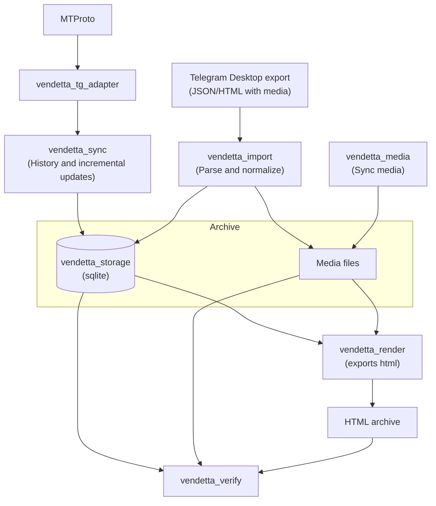
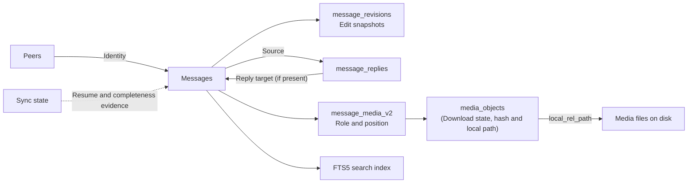
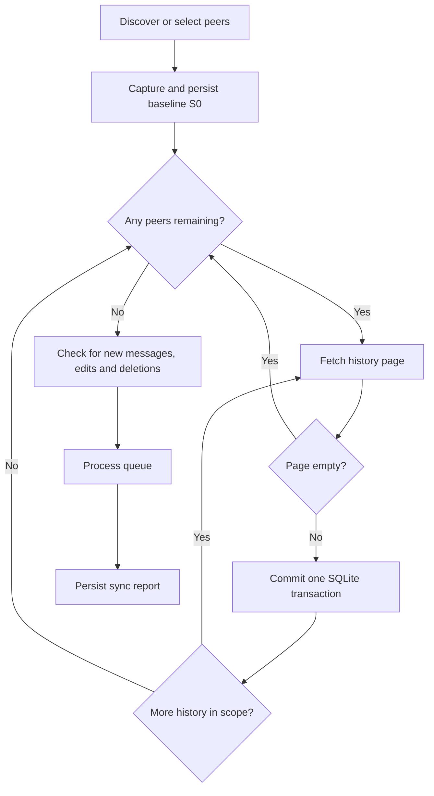

# System Architecture

Vendetta archives Telegram messages in SQLite and stores media as files on disk. It can fetch data through MTProto or import a Telegram Desktop export. The local archive supplies the data for offline HTML generation and integrity checks.

## Data flow

The diagram shows how data reaches the local archive and how rendering and verification read it. Arrows represent data movement between components.

The `convert tdesktop` command imports into a temporary SQLite archive and media directory, then renders HTML from them. An existing archive can also be rendered or verified independently.

### Archive structure

Messages use `(peer_id, message_id)` pair. Revisions, replies, and media links refer to that; reply records retain the target and its resolution status even when the target message is absent. 

The diagram shows these logical relationships; the migrations define the complete schema and its foreign-key constraints.

## Synchronization

Full synchronization records a baseline before fetching message history. Once the history scan finishes, it reconciles updates from that baseline, processes the channel queue, and records an integrity report.

The page transaction commits messages and their history cursor together. A ranged history backfill does not advance the full-history cursor.

Media downloads use a separate queue. The `backfill-media` command populates it from archived raw TL; `download-media` can perform this scan before downloading. Workers claim entries, fetch chunks through the adapter, verify server range hashes, and persist download offsets. Completed downloads use SHA-256 content-addressed paths. The scheduler controls concurrency, per-DC limits, and FLOOD_WAIT backoff.

#### Note: The `export-html` and `verify-archive` commands run separately against the local archive

## Crate strcutre

- `vendetta_cli` - CLI wrapper

- `vendetta_tg_adapter` - Wrapper around `grammers-client`. Also responses for authentication, sessions, dialog syncing, Takeout sessions, and raw TL operations. It normalizes Telegram responses into the records defined by `vendetta_model`, including `PeerRecord`, `MessageRecord`, `MessageRevisionRecord`, and `MediaRecord`. This crate has no dependency on MTProto library types

- `vendetta_storage` - basically storage class that uses SQLite with WAL mode and is shared through a mutex. 

- `vendetta_sync` coordinates history ingestion and incremental reconciliation through `updates.getDifference` and `updates.getChannelDifference`, including gap recovery and deletion tombstones.

- `vendetta_media` owns the download queue, resumable transfers, content-addressed deduplication, and disk verification.

- `vendetta_render` reads the archive and generates HTML.

- `vendetta_import` parses original TDesktop's JSON/HTML export, copies media, and feeds the same storage and rendering path.

- `vendetta_verify` audits the archive and generated output. It checks schema and foreign-key constraints, message states, reply cycles, media hashes, HTML links, search indexes, and recorded synchronization provenance.
